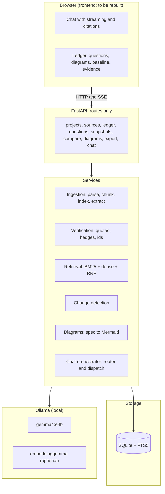
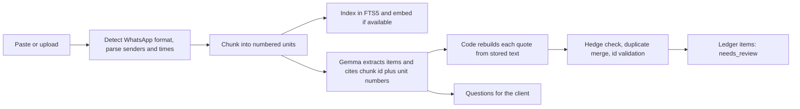
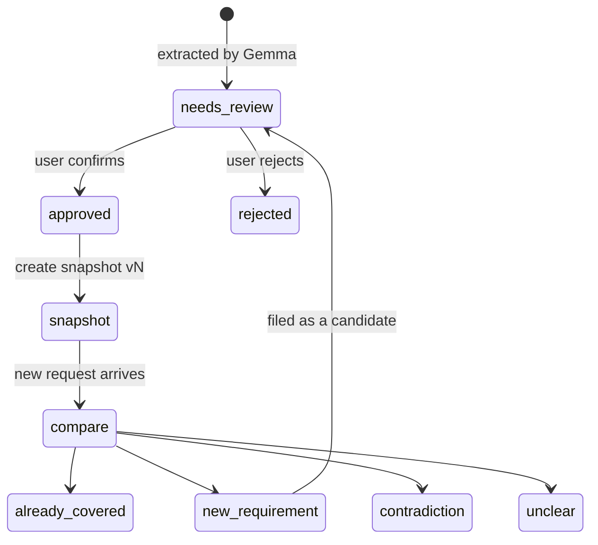

 

# ArchLens

**Every scope decision has a receipt.**

ArchLens turns messy client conversations (pasted notes, WhatsApp exports, Hinglish included) into an evidence-backed **scope ledger**. Every extracted requirement links to the exact words it came from. It flags what is uncertain, drafts the clarification message for the client, freezes an approved scope baseline, and checks new requests against that baseline. A project-scoped chat assistant, powered by Gemma, can answer questions about the conversation and drive all of it.

Everything runs against a local [Ollama](https://ollama.com) server. No cloud AI provider is called.

> **Status (backend v0.2):** the backend is complete for text and WhatsApp input and has been exercised end to end against live `gemma4:e4b`. **The frontend has not been rebuilt yet**: the `frontend/` folder is the previous version and does not match this API. PDF, image and WAV import work on generated test files. See [Not built yet](#not-built-yet).

---

## How it works



### From source to ledger



### Scope lifecycle



## Why you can trust the evidence

Small local models paraphrase and invent, so provenance is never taken from the model:

- **Citation by number.** The model cites a chunk id and unit (message) numbers. Code rebuilds the quote from stored text, so a quote cannot be misquoted. Free-text quotes are checked with whitespace-normalised exact matching.
- **Invented evidence is dropped.** Items whose chunk ids or unit numbers do not exist are discarded and reported in the job result, never silently kept.
- **Hedges cap certainty.** A statement containing a hedge ("maybe", "not sure", "shayad", "pakka nahi", Devanagari equivalents) cannot stay `explicit`; it is lowered to `tentative`, with a note. This is a heuristic cross-check, not the only classifier.
- **The model cannot approve scope.** Every new item enters as `needs_review`. Approval is a separate field from evidence certainty. Snapshots contain approved items only and are immutable.
- **Ids are validated.** Cited baseline ids, chunk ids and diagram references are checked in code; unsupported verdicts are downgraded to `unclear`; diagram edges to undefined nodes are dropped and reported.
- **Project isolation.** Every query and every id is checked against the project.
- **Chat is grounded.** Answers are written only from retrieved passages. Citation markers are validated against what was supplied, answers with no valid citation are flagged `grounded: false`, and when retrieval finds nothing the assistant says so without calling the model. Chat never approves, rejects or snapshots anything.
- **Imported text is data.** Prompts tell the model to ignore instructions inside client content.

## Setup

Requires Python 3.11+ (developed on 3.13) and [Ollama](https://ollama.com/download).

```bash
ollama pull gemma4:e4b
ollama pull embeddinggemma        # optional; without it retrieval is BM25-only
```

```bash
cd backend
python -m venv venv
venv\Scripts\activate             # Windows
# source venv/bin/activate        # macOS / Linux
pip install -r requirements.txt
cp .env.example .env
python -m scripts.check_setup     # verifies FTS5, models, structured output and speed
uvicorn app.main:app --reload     # http://127.0.0.1:8000 , docs at /docs
```

Seed the labelled demo project (a short Hinglish WhatsApp chat) through the real pipeline:

```bash
curl -X POST http://127.0.0.1:8000/api/demo/seed
```

### Configuration (`backend/.env`)

| Variable                                    | Default                    | Purpose                                                                                          |
| ------------------------------------------- | -------------------------- | ------------------------------------------------------------------------------------------------ |
| `OLLAMA_BASE_URL`                         | `http://127.0.0.1:11434` | Local Ollama endpoint                                                                            |
| `OLLAMA_MODEL`                            | `gemma4:e4b`             | Chat, extraction and diagram model                                                               |
| `OLLAMA_EMBED_MODEL`                      | `embeddinggemma`         | Dense embeddings (optional)                                                                      |
| `OLLAMA_NUM_CTX` / `OLLAMA_NUM_PREDICT` | `16384` / `4096`       | Context window and output limit; hitting the limit is an explicit error                          |
| `OLLAMA_THINK`                            | `false`                  | Gemma 4 is a thinking model; with thinking on it can spend the whole budget before emitting JSON |
| `OLLAMA_TIMEOUT_SECONDS`                  | `600`                    | Per-request timeout                                                                              |
| `ARCHLENS_DATA_DIR`                       | `./data`                 | SQLite database and uploads                                                                      |
| `MAX_UPLOAD_BYTES`                        | `20971520`               | Upload size limit                                                                                |

`EMBED_QUERY_PREFIX` and `EMBED_DOCUMENT_PREFIX` hold EmbeddingGemma's task prompts. They match Google's published EmbeddingGemma retrieval templates (`task: search result | query: ` and `title: none | text: `); Ollama's template for this model is raw, so the application adds them.

## API (prefix `/api`)

| Method               | Path                              | Purpose                                                                         |
| -------------------- | --------------------------------- | ------------------------------------------------------------------------------- |
| GET                  | `/health`                       | Ollama, models, retrieval mode (`hybrid` or `bm25_only`), privacy statement |
| POST / GET           | `/projects`                     | Create / list                                                                   |
| GET / PATCH / DELETE | `/projects/{id}`                | Read / update / delete with its data and search index                           |
| GET / POST           | `/projects/{id}/sources`        | List / add pasted text (JSON)                                                   |
| POST                 | `/projects/{id}/sources/upload` | `.txt`, `.md`, `.pdf`, `.png`, `.jpg`, `.webp` or `.wav` upload   |
| GET / PATCH          | `/projects/{id}/sources/{sid}`  | Source with chunks / set which sender is "you"                                  |
| GET                  | `/jobs/{id}`                    | Real stage and progress of ingestion                                            |
| GET                  | `/projects/{id}/ledger`         | Items, filterable by status and type                                            |
| GET / PATCH          | `/ledger-items/{id}`            | Item with evidence and source context / edit, approve, reject                   |
| GET                  | `/projects/{id}/questions`      | Open questions                                                                  |
| PATCH                | `/questions/{id}`               | Resolve or dismiss                                                              |
| POST                 | `/projects/{id}/draft-message`  | Editable English or Hinglish client message                                     |
| POST / GET           | `/projects/{id}/snapshots`      | Create an immutable baseline from approved items / list                         |
| POST                 | `/projects/{id}/compare`        | Classify an incoming request against a snapshot                                 |
| GET                  | `/change-reports/{id}`          | A stored comparison                                                             |
| POST / GET           | `/projects/{id}/diagrams`       | Generate a diagram from the ledger / list                                       |
| GET                  | `/projects/{id}/export.md`      | Markdown scope brief                                                            |
| POST                 | `/projects/{id}/chat`           | Chat turn as a server-sent event stream                                         |
| GET                  | `/projects/{id}/chat/messages`  | Chat history                                                                    |
| POST                 | `/demo/seed`                    | Labelled demo project                                                           |

**Chat stream events:** `thread`, `status`, `token`, `replace` (citation markers cleaned), `card` (ledger list, questions, draft message, diagram, change report, confirm-add-source, error), `citations` (with `grounded`), `error`, `done`.

## Measured so far

Single runs on one machine (RTX 4060 Laptop 8 GB, Windows 11, Ollama 0.40.2, `gemma4:e4b`, thinking off) with **one synthetic 12-message Hinglish chat**. These are indications, not benchmarks, and extraction quality has not been evaluated beyond reading the output.

| Operation                                                                          | Observed          |
| ---------------------------------------------------------------------------------- | ----------------- |
| Import demo chat to ledger (7 items, 2 questions, every quote verified, 0 dropped) | 28 s              |
| Chat turn, grounded answer (router + retrieval + streamed answer)                  | about 1.9 s total |
| Router call                                                                        | 0.6 to 1.1 s      |
| Draft client message                                                               | about 1 s         |
| Diagram from ledger                                                                | about 3 s         |
| Compare a request to a snapshot                                                    | about 2 to 3 s    |

The numbers above were measured with BM25-only retrieval. After installing `embeddinggemma` the chat reported `hybrid` mode and returned grounded, cited answers for English and Hinglish questions on the demo chat (four ad hoc queries, one of which returned no output). Retrieval quality has not been measured; no recall figures exist yet.

## Tests

```bash
cd backend
pytest
```

90 tests covering the WhatsApp parser, chunking, hedges, quote verification, RRF, FTS5 (including Hindi), hybrid retrieval and BM25-only fallback, extraction provenance, the full HTTP flow, project isolation, chat streaming and grounding, and the Mermaid compiler. The model is faked, so no Ollama server is needed.

## Evaluation

A live harness (`backend/evals`) measures extraction recall, hedge handling, router accuracy, retrieval (BM25 vs dense vs hybrid) and change detection on small synthetic sets. Results, caveats and held-out numbers are in [docs/EVALUATION.md](docs/EVALUATION.md); backend internals are in [docs/BACKEND.md](docs/BACKEND.md).

## Not built yet

- **Frontend rebuild** (the chat-first, light glassmorphic interface). The existing `frontend/` is the previous version.
- **Real-world media testing.** PDF, image and WAV import work end to end on generated files only; real photos, noisy audio, Hinglish speech and other audio formats are untested. Audio goes in the Ollama `images` field (the `audio` field is silently ignored).
- OCR boxes, speaker diarization, reranking, chat-driven approvals (by design), a retrieval and extraction quality evaluation.
- Duplicate detection is title similarity only, so paraphrased duplicates are not merged.
- The extraction can miss items (in the demo run the unresolved refund rule became a question but not an item).

## Privacy

Model inference runs locally through Ollama and no cloud AI provider is used. Model downloads and development tooling can still use the network, and the app does not claim zero outbound traffic. Data is stored in `ARCHLENS_DATA_DIR` (default `./data`, git-ignored); if that folder lives in a synced directory such as OneDrive, it syncs. Private message content is not logged.

## License

MIT. See [LICENSE](LICENSE).
