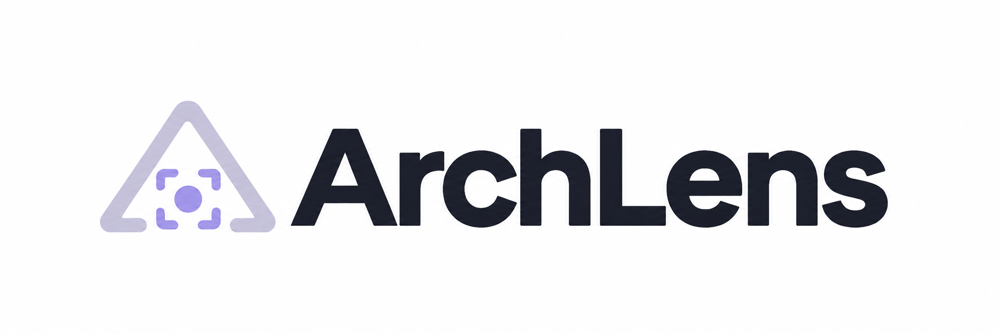
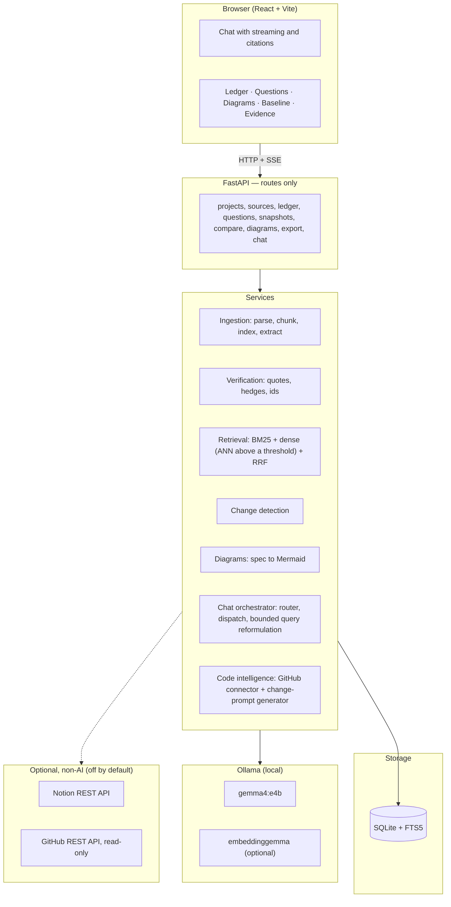
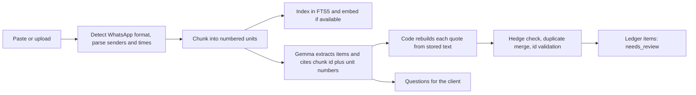
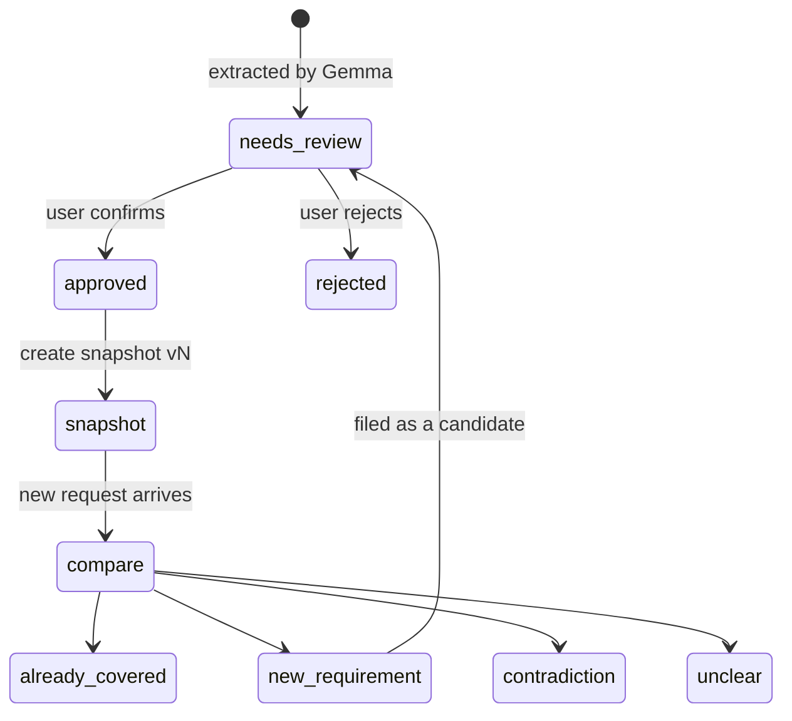

<p align="center">
  
</p>

<h3 align="center">Every scope decision has a receipt.</h3>

<p align="center">
  ArchLens turns messy client conversations — pasted notes, WhatsApp exports, voice memos, Hinglish included — into an evidence-backed <strong>scope ledger</strong>. Every extracted requirement links back to the exact words it came from.
</p>

<p align="center">
  <strong>100% local AI · No cloud AI provider · Powered by <a href="https://ollama.com">Ollama</a> + Gemma</strong>
</p>

<p align="center">
  <sub>All <em>inference</em> stays on your machine through local Ollama. Two optional, off-by-default integrations (Notion export, a read-only GitHub connector) do make their own non-AI network calls when you explicitly configure them — see <a href="#optional-integrations">Optional integrations</a>.</sub>
</p>

---

## Screenshots

<table>
  <tr>
    <td align="center">
      <br/>
      <sub><b>Landing page</b> — Start a new project or try the demo</sub>
    </td>
  </tr>
  <tr>
    <td align="center">
      <br/>
      <sub><b>Chat + Scope Ledger</b> — Ask questions about the project, see extracted requirements with evidence status badges in real-time</sub>
    </td>
  </tr>
  <tr>
    <td align="center">
      <br/>
      <sub><b>Auto-generated diagrams</b> — Architecture, component, sequence, ER, and requirements diagrams from the ledger — exportable as SVG, PNG or PDF</sub>
    </td>
  </tr>
</table>

---

## What it does

ArchLens takes a messy client conversation and turns it into a structured, evidence-backed scope ledger in seconds:

1. **Ingest** — paste text, drop a WhatsApp export `.txt`, upload a PDF, image, or voice note (`.wav`)
2. **Extract** — Gemma reads the conversation and pulls out requirements, constraints, decisions, and assumptions, each citing the exact chunk and message it came from
3. **Verify** — code (not the model) reconstructs every quote from stored text; invented evidence is dropped; hedged statements (`"maybe"`, `"shayad"`, `"pakka nahi"`) are automatically downgraded to `tentative`
4. **Review** — you approve or reject each item; nothing is approved by the AI
5. **Baseline** — freeze an immutable snapshot of approved items at any point
6. **Compare** — paste a new client request and check it against the baseline: already covered, new requirement, contradiction, or unclear
7. **Diagrams** — generate architecture, sequence, ER, component, or requirements traceability diagrams from the live ledger; download as SVG, PNG or PDF
8. **Chat** — a project-scoped assistant answers questions grounded in your sources and ledger, drafts client messages, lists open questions, and can trigger diagrams and comparisons
9. **Export to Notion** *(optional)* — push the scope brief to a new Notion page, titled after the project
10. **Connect a GitHub repo** *(optional, read-only)* — index a codebase for retrieval only, kept in a separate search domain from your conversations so code can never leak into a chat answer and a client's words can never leak into "affected files"
11. **Hand off to your own coding agent** — turn an approved item into a short implementation brief citing only files actually retrieved from the connected repo, ready to paste into Claude Code, Cursor, Copilot or any other assistant. ArchLens never writes to the repo or opens anything itself.

---

## Tech Stack

### Backend

| Layer                       | Technology                                                                                      |
| --------------------------- | ----------------------------------------------------------------------------------------------- |
| **Runtime**           | Python 3.11+ (developed on 3.13)                                                                |
| **API Framework**     | [FastAPI](https://fastapi.tiangolo.com/) ≥ 0.115                                                |
| **Server**            | [Uvicorn](https://www.uvicorn.org/) with standard extras                                         |
| **Data validation**   | [Pydantic](https://docs.pydantic.dev/) v2 + pydantic-settings                                    |
| **ORM / DB driver**   | [SQLAlchemy](https://www.sqlalchemy.org/) 2.0 async + [aiosqlite](https://aiosqlite.omnilib.dev/) |
| **Database**          | SQLite with**FTS5** (full-text search, including Hindi)                                   |
| **LLM inference**     | [Ollama](https://ollama.com/) local server — `gemma4:e4b` for chat, extraction, diagrams      |
| **Embeddings**        | `embeddinggemma` via Ollama (optional; falls back to BM25-only retrieval)                     |
| **Vector index**      | [hnswlib](https://github.com/nmslib/hnswlib) for approximate nearest-neighbour search            |
| **Retrieval**         | BM25 (FTS5) + dense (hnswlib) fused with**Reciprocal Rank Fusion (RRF)**                  |
| **HTTP client**       | [httpx](https://www.python-httpx.org/) (async, for Ollama calls)                                 |
| **PDF parsing**       | [pypdf](https://pypdf.readthedocs.io/) + [pypdfium2](https://pypdfium2.readthedocs.io/)           |
| **Structured output** | JSON schema-constrained Ollama calls validated by Pydantic                                      |
| **Rate limiting**     | [slowapi](https://github.com/laurents/slowapi)                                                   |
| **Notion export**     | Notion REST API via httpx (optional, off until `NOTION_API_KEY` is set)                       |
| **GitHub connector**  | GitHub REST API via httpx (optional, read-only, off until `GITHUB_READ_TOKEN` is set)          |
| **Logging**           | [structlog](https://www.structlog.org/)                                                          |
| **Config**            | python-dotenv / pydantic-settings via`backend/.env`                                           |
| **Testing**           | pytest + pytest-asyncio — 108 tests, no live Ollama needed                                     |

### Frontend

| Layer                          | Technology                                                                                  |
| ------------------------------ | ------------------------------------------------------------------------------------------- |
| **Framework**            | [React](https://react.dev/) 19                                                               |
| **Build tool**           | [Vite](https://vitejs.dev/) 8                                                                |
| **Language**             | TypeScript 6                                                                                |
| **Styling**              | [Tailwind CSS](https://tailwindcss.com/) v4 (via `@tailwindcss/vite`)                      |
| **Component primitives** | [Radix UI](https://www.radix-ui.com/) (headless, accessible)                                 |
| **UI components**        | [shadcn/ui](https://ui.shadcn.com/) + custom glassmorphic design system                      |
| **Data fetching**        | [TanStack Query](https://tanstack.com/query) v5                                              |
| **Routing**              | [React Router](https://reactrouter.com/) v7                                                  |
| **Streaming**            | Native`EventSource` / SSE for real-time chat tokens                                       |
| **Diagrams**             | [Mermaid.js](https://mermaid.js.org/) v12 — rendered client-side, exportable as SVG/PNG/PDF |
| **Animations**           | [Motion](https://motion.dev/) (Framer Motion)                                                |
| **Physics**              | [matter-js](https://brm.io/matter-js/) (landing page)                                        |
| **Toasts**               | [Sonner](https://sonner.emilkowal.ski/)                                                      |
| **Icons**                | Lucide React + HugeIcons                                                                    |
| **Typography**           | Plus Jakarta Sans · Fraunces · IBM Plex Mono (via @fontsource)                            |
| **Linting**              | oxlint                                                                                      |

---

## How it works



### From source to ledger



### Scope lifecycle



---

## Why you can trust the evidence

Small local models paraphrase and invent, so provenance is never taken from the model:

- **Citation by number.** The model cites a chunk id and unit (message) numbers. Code rebuilds the quote from stored text, so a quote cannot be misquoted. Free-text quotes are checked with whitespace-normalised exact matching.
- **Invented evidence is dropped.** Items whose chunk ids or unit numbers do not exist are discarded and reported in the job result, never silently kept.
- **Hedges cap certainty.** A statement containing a hedge (`"maybe"`, `"not sure"`, `"shayad"`, `"pakka nahi"`, Devanagari equivalents) cannot stay `explicit`; it is lowered to `tentative`, with a note.
- **The model cannot approve scope.** Every new item enters as `needs_review`. Approval is a separate field from evidence certainty. Snapshots contain approved items only and are immutable.
- **Ids are validated.** Cited baseline ids, chunk ids and diagram references are checked in code; unsupported verdicts are downgraded to `unclear`; diagram edges to undefined nodes are dropped and reported.
- **Project isolation.** Every query and every id is checked against the project.
- **Chat is grounded.** Answers are written only from retrieved passages. Citation markers are validated against what was supplied; answers with no valid citation are flagged `grounded: false`; when retrieval finds nothing the assistant says so without calling the model. Chat never approves, rejects or snapshots anything.
- **Imported text is data.** Prompts tell the model to ignore instructions inside client content.

---

## Optional integrations

Both are off until you set their credentials in `backend/.env`; neither is required for anything else in this list.

- **Notion export** (`POST /projects/{id}/export/notion`) — converts the exact same scope brief the Markdown export already produces into Notion blocks and creates a page under a parent page you share with your integration once. No model call, no new content — just a different output format for data that already exists.
- **GitHub connector, read-only** (`POST /projects/{id}/sources/github`) — connects a repo (`owner/repo` or a full URL) via the GitHub REST API: no `git clone`, no disk checkout, no write scope on the token at all. Vendor/build directories, lockfiles and oversized/binary files are filtered out before anything is indexed.
  - A connected repo's code is chunked, embedded and FTS-indexed exactly like any other source — **but it is never extracted into ledger items.** A codebase is reference material for "what does this touch", not something a client said.
  - Code chunks and conversation chunks are strictly partitioned at retrieval time: chat answers and change detection can never surface a line of code, and an "affected files" lookup can never surface something from the client's chat. Same database, same retrieval engine, two domains that never mix.
- **Implementation-brief handoff** (`POST /ledger-items/{id}/prompt`) — turns an approved or candidate ledger item into a short, evidence-grounded brief for your own coding agent (Claude Code, Cursor, Copilot, or `target: "generic"` for anything else). The model is only ever given numbered `[F#]` markers for candidate files, never real paths — any marker it invents is stripped before you see it, and the ones it legitimately used are substituted for the real `path:line-range` in code, not by the model. This is the terminal output of the whole pipeline: ArchLens never writes to the repo, opens a branch, or creates a PR itself.

---

## Setup

### Requirements

- Python 3.11+ (developed on 3.13)
- Node.js 18+ and npm
- [Ollama](https://ollama.com/download)

### 1. Pull the models

```bash
ollama pull gemma4:e4b
ollama pull embeddinggemma        # optional — enables hybrid retrieval
```

### 2. Start the backend

```bash
cd backend
python -m venv venv
venv\Scripts\activate             # Windows
# source venv/bin/activate        # macOS / Linux
pip install -r requirements.txt
cp .env.example .env
python -m scripts.check_setup     # verifies FTS5, models, structured output and speed
uvicorn app.main:app --reload     # http://127.0.0.1:8000 · API docs at /docs
```

### 3. Start the frontend

```bash
cd frontend
npm install
npm run dev                       # http://localhost:5173
```

### 4. (Optional) Seed the demo project

Seed a labelled Hinglish WhatsApp demo chat through the real pipeline:

```bash
curl -X POST http://127.0.0.1:8000/api/demo/seed
```

Then open `http://localhost:5173`, click **Try the demo**, and explore.

### Stopping everything

```powershell
# Kill by port (PowerShell)
Get-NetTCPConnection -LocalPort 5173,8000 -ErrorAction SilentlyContinue | ForEach-Object { Stop-Process -Id $_.OwningProcess -Force }

# Or by process name
taskkill /F /IM node.exe
taskkill /F /IM python.exe
```

---

## Configuration (`backend/.env`)

| Variable                                    | Default                    | Purpose                                                                                          |
| ------------------------------------------- | -------------------------- | ------------------------------------------------------------------------------------------------ |
| `OLLAMA_BASE_URL`                         | `http://127.0.0.1:11434` | Local Ollama endpoint                                                                            |
| `OLLAMA_MODEL`                            | `gemma4:e4b`             | Chat, extraction and diagram model                                                               |
| `OLLAMA_EMBED_MODEL`                      | `embeddinggemma`         | Dense embeddings (optional)                                                                      |
| `OLLAMA_NUM_CTX` / `OLLAMA_NUM_PREDICT` | `16384` / `4096`       | Context window and output limit; hitting the limit is an explicit error                          |
| `OLLAMA_THINK`                            | `false`                  | Gemma 4 is a thinking model; with thinking on it can spend the whole budget before emitting JSON |
| `OLLAMA_TIMEOUT_SECONDS`                  | `600`                    | Per-request timeout                                                                              |
| `ARCHLENS_DATA_DIR`                       | `./data`                 | SQLite database and uploads                                                                      |
| `MAX_UPLOAD_BYTES`                        | `20971520`               | Upload size limit (20 MB)                                                                        |
| `ANN_ENABLED` / `ANN_MIN_VECTORS`       | `true` / `500`        | Use an HNSW index above this many chunks per project; exact brute-force cosine below it            |
| `RATE_LIMIT_ENABLED`                      | `true`                   | Per-IP rate limiting (slowapi)                                                                    |
| `RATE_LIMIT_DEFAULT` / `RATE_LIMIT_LLM` | `60/minute` / `10/minute` | App-wide default, and the stricter limit on every route that calls Gemma                           |
| `NOTION_API_KEY` / `NOTION_PARENT_PAGE_ID` | _(unset)_               | Optional Notion export — internal integration token + the parent page id to create pages under   |
| `GITHUB_READ_TOKEN`                       | _(unset)_               | Optional GitHub connector — fine-grained PAT, all-repos, **Contents: Read-only**, nothing else |

`EMBED_QUERY_PREFIX` and `EMBED_DOCUMENT_PREFIX` hold EmbeddingGemma's task prompts matching Google's published templates; Ollama's template for this model is raw, so the application adds them.

---

## API Reference (prefix `/api`)

| Method               | Path                              | Purpose                                                                      |
| -------------------- | --------------------------------- | ---------------------------------------------------------------------------- |
| GET                  | `/health`                       | Ollama reachability, models, retrieval mode, privacy statement               |
| POST / GET           | `/projects`                     | Create / list projects                                                       |
| GET / PATCH / DELETE | `/projects/{id}`                | Read / update / delete with its data and search index                        |
| GET / POST           | `/projects/{id}/sources`        | List / add pasted text (JSON)                                                |
| POST                 | `/projects/{id}/sources/upload` | Upload`.txt`, `.md`, `.pdf`, `.png`, `.jpg`, `.webp` or `.wav` |
| POST                 | `/projects/{id}/sources/github` | Connect a repo (read-only, optional) -- indexed for retrieval only, never extracted into ledger items |
| GET / PATCH          | `/projects/{id}/sources/{sid}`  | Source with chunks / set which sender is "you"                               |
| GET                  | `/jobs/{id}`                    | Real-time stage and progress of an ingestion job                             |
| GET                  | `/projects/{id}/ledger`         | Items, filterable by status and type                                         |
| GET / PATCH          | `/ledger-items/{id}`            | Item with evidence and source context / edit, approve, reject                |
| POST                 | `/ledger-items/{id}/prompt`     | Implementation brief for your own coding agent (optional, needs a connected repo) |
| GET                  | `/projects/{id}/questions`      | Open questions for the client                                                |
| PATCH                | `/questions/{id}`               | Resolve or dismiss a question                                                |
| POST                 | `/projects/{id}/draft-message`  | Editable English or Hinglish client message                                  |
| POST / GET           | `/projects/{id}/snapshots`      | Create an immutable baseline / list snapshots                                |
| POST                 | `/projects/{id}/compare`        | Classify an incoming request against a snapshot                              |
| GET                  | `/change-reports/{id}`          | A stored comparison report                                                   |
| POST / GET           | `/projects/{id}/diagrams`       | Generate a Mermaid diagram from the ledger / list                            |
| GET                  | `/projects/{id}/export.md`      | Export scope brief as Markdown                                               |
| POST                 | `/projects/{id}/export/notion`  | Export scope brief to Notion (optional, needs Notion configured)             |
| POST                 | `/projects/{id}/chat`           | Chat turn as a server-sent event stream                                      |
| GET                  | `/projects/{id}/chat/messages`  | Chat history                                                                 |
| POST                 | `/demo/seed`                    | Seed the labelled demo project                                               |

**Chat stream event types:** `thread` · `status` (stages: `routing`, `searching`, `reformulating`, `writing`, `drafting`, `drawing`, `comparing`) · `token` · `replace` (citation cleanup) · `card` (ledger list, questions, draft, diagram, change report, confirm-add-source, error) · `citations` · `error` · `done`

**Chat intents handled:** `answer_question` (retrieval-grounded, with one bounded query-reformulation retry if the first search finds nothing) · `list_ledger` · `open_questions` · `draft_message` · `create_diagram` · `compare_request` · `off_topic` (blocked)

---

## Performance

Single runs on one machine (RTX 4060 Laptop 8 GB, Windows 11, Ollama 0.40.2, `gemma4:e4b`, thinking off) with a synthetic 12-message Hinglish chat. These are indications, not benchmarks.

| Operation                                                                          | Observed     |
| ---------------------------------------------------------------------------------- | ------------ |
| Import demo chat to ledger (7 items, 2 questions, every quote verified, 0 dropped) | 28 s         |
| Chat turn, grounded answer (router + retrieval + streamed answer)                  | ~1.9 s total |
| Router call                                                                        | 0.6–1.1 s   |
| Draft client message                                                               | ~1 s         |
| Diagram from ledger                                                                | ~3 s         |
| Compare a request to a snapshot                                                    | ~2–3 s      |

---

## Tests

```bash
cd backend
pytest
```

108 tests covering: WhatsApp parser, chunking, hedges, quote verification, RRF, FTS5 (including Hindi), hybrid retrieval and BM25-only fallback, the code/conversation retrieval domain partition, extraction provenance, GitHub repo parsing/filtering/chunking, full HTTP flow, project isolation, chat streaming and grounding, query reformulation, and the Mermaid compiler. The model is faked — no Ollama server needed.

---

## Evaluation

A live harness (`backend/evals`) measures extraction recall, hedge handling, router accuracy, retrieval (BM25 vs dense vs hybrid) and change detection on small synthetic sets. Results, caveats and held-out numbers are in [docs/EVALUATION.md](docs/EVALUATION.md); backend internals are in [docs/BACKEND.md](docs/BACKEND.md).

---

## Privacy

Model inference runs entirely locally through Ollama — no cloud AI provider is called. Model downloads and development tooling can still use the network. Data is stored in `ARCHLENS_DATA_DIR` (default `./data`, git-ignored). Private message content is not logged. The two optional integrations ([Notion export](#optional-integrations), the GitHub connector) are off until you set their credentials yourself; when enabled, they call Notion's/GitHub's own APIs directly — never an AI provider, and the GitHub token is read-only by design.

---

## License

MIT. See [LICENSE](LICENSE).
