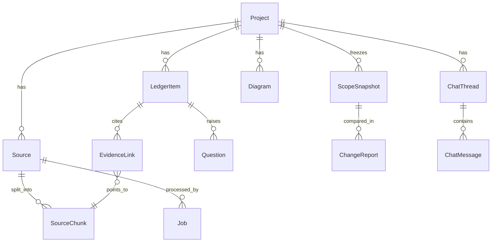
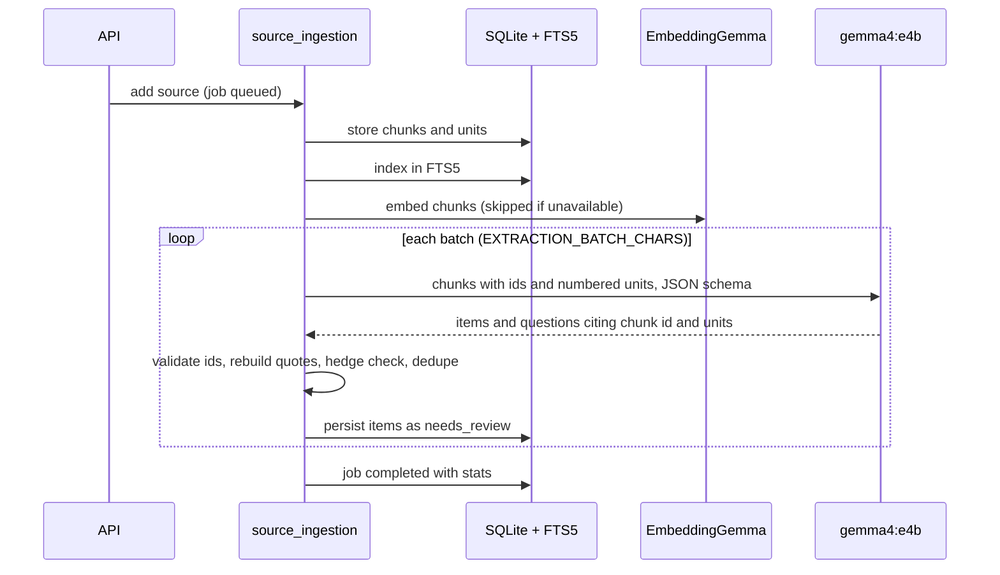
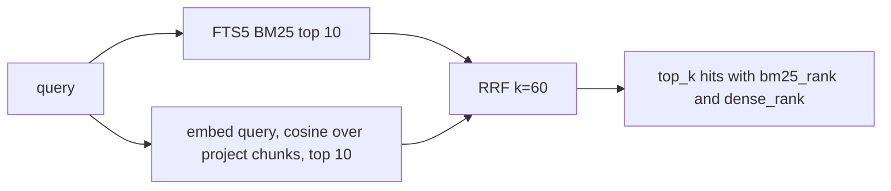
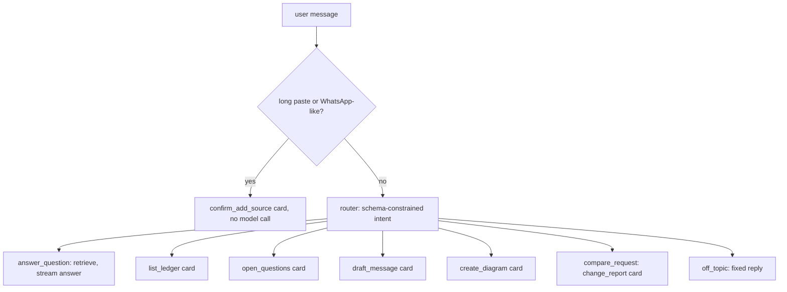

# ArchLens backend

Technical documentation for backend v0.2. For the API contract aimed at UI work see [FRONTEND_HANDOFF.md](FRONTEND_HANDOFF.md); for measured quality see [EVALUATION.md](EVALUATION.md).

## 1. Design goals

1. **Evidence or it does not exist.** Every ledger item must trace to the exact words of a source. Provenance is computed by code, never trusted from the model.
2. **The model proposes, the human decides.** Gemma never approves scope. Snapshots contain approved items only and cannot be edited.
3. **Local only.** All inference goes to a local Ollama server. There is no cloud AI client in the codebase.
4. **Degrade honestly.** If embeddings are missing, retrieval says it is BM25-only. If the model returns invalid output, the job fails with a message instead of storing guesses.

## 2. Stack

| Concern | Choice |
|---|---|
| Web | FastAPI, Pydantic v2, server-sent events for chat |
| Storage | SQLite (WAL, `foreign_keys=ON`, `busy_timeout`), async SQLAlchemy 2 with aiosqlite |
| Lexical search | SQLite FTS5 (BM25), Devanagari combining marks added via `tokenchars` |
| Dense search | EmbeddingGemma through Ollama `/api/embed`, vectors stored as JSON, NumPy brute-force cosine (adequate at project scale; no ANN index) |
| Fusion | Reciprocal Rank Fusion, `k = 60`, ranks only (scores from the two systems are not comparable), dense channel weight `RRF_DENSE_WEIGHT=2.0` |
| LLM | `gemma4:e4b` through Ollama `/api/chat` with JSON-schema `format`, `think:false`, explicit `num_ctx` and `num_predict` |
| Logging | structlog; private message content is not logged unless `LOG_SENSITIVE_CONTENT=true` |

## 3. Layout

```
backend/
  app/
    main.py            app factory, lifespan (DB init, Ollama client), OllamaError handler, CORS
    config.py          Settings (env + .env)
    database.py        engine, pragmas, FTS5 virtual tables (chunk_fts, item_fts)
    models.py          SQLAlchemy models
    schemas.py         LLM output contracts and API payloads
    diagram_specs.py   Pydantic specs for the five diagram types
    enums.py           shared enums
    deps.py            dependency providers (tests override these)
    api/               thin route modules, no business logic
    services/          all behaviour (below)
    prompts/*.txt      model prompts: extraction, router, answer, change_detection, draft_message, diagram_spec
    demo/              labelled demo chat and an example incoming request
  scripts/check_setup.py   preflight: FTS5, Ollama, models, schema-constrained smoke test, tokens/s
  tests/                   90 tests, model faked
  evals/                   live evaluation harness (see EVALUATION.md)
```

### Services

| Module | Responsibility |
|---|---|
| `ollama_client.py` | `chat`, `chat_json` (schema validation plus one repair retry), `stream_chat`, `embed`, `health`. Typed errors: unavailable, model missing, timeout, bad response. Hitting `num_predict` is an explicit error, not a truncated answer. |
| `whatsapp_parser.py` | Detects WhatsApp exports (several date formats, ambiguity flagged), extracts senders, timestamps, multi-line messages, system lines. |
| `chunking.py` | Turns messages (or sentences of plain text) into numbered **units** and groups them into chunks of about `CHUNK_TARGET_CHARS`. Units carry sender and time. |
| `source_ingestion.py` | Creates sources, stores chunks, indexes them (FTS5 plus embeddings), runs extraction batches, updates the job with real stages (`reading`, `transcribing` for media, `indexing`, `extracting n/m`). |
| `media_ingestion.py` | PDF, image and audio to text (section 5a). |
| `extraction.py` | Builds the prompt, validates model output, persists items, evidence and questions. |
| `evidence_verification.py` | Rebuilds quotes from stored units and checks free-text phrases with whitespace-normalised exact matching. |
| `hedging.py` | English, Hinglish and Devanagari hedge lexicon. A hedged statement cannot remain `explicit`. |
| `ledger.py` | Display ids (`REQ-1`), duplicate merge by lightly stemmed token Jaccard (threshold 0.75), item serialisation. |
| `lexical_search.py` / `embeddings.py` / `rrf.py` / `hybrid_retrieval.py` | Retrieval (section 6). |
| `snapshots.py` | Immutable baselines from approved items. |
| `change_detection.py` | Classifies an incoming request against a snapshot (section 7). |
| `draft_message.py` | English or Hinglish client message covering open questions. |
| `diagrams.py` / `mermaid_generator.py` | Model fills a structured spec, code compiles Mermaid (section 8). |
| `export_service.py` | Markdown scope brief. |
| `chat_orchestrator.py` | Router, dispatch, grounded answers, SSE events (section 9). |
| `jobs.py` | Job bookkeeping in short independent transactions so polling sees live progress. |

## 4. Data model



Key fields:

- **SourceChunk**: `text`, `units_json` (numbered messages with sender and time), `embedding_json`, `content_hash`.
- **LedgerItem**: `display_id`, `item_type`, `title`, `description`, `evidence_status` (how firmly it was said), `approval_status` (the human decision), `risk_level`, `stated_by`, `active`.
- **EvidenceLink**: `quote`, `highlight`, `unit_numbers`, `speaker`, `speaker_role`, `verification_status`, `verification_note`.
- **ScopeSnapshot**: `version`, `label`, `snapshot_json` (frozen copy of approved items).
- Timestamps use a UTC-aware `UTCDateTime` type. Deleting a project cascades and also clears the FTS rows.

## 5. Ingestion and extraction pipeline



Provenance rules enforced in code (`extraction.py`, `evidence_verification.py`):

1. The model cites `chunk_id` plus unit numbers. Quotes are reconstructed from the stored units, so they cannot be paraphrased or misquoted. An optional `phrase` is verified by normalised exact match, else the link is marked `unverified`.
2. A citation to a chunk or unit that does not exist is dropped and counted in the job result (`dropped_items`, also `hedge_downgrades`, `items_merged`). An item left with no valid evidence is discarded, never kept.
3. If the cited text contains a hedge, `evidence_status` is lowered from `explicit` to `tentative` and `verification_note` says why.
4. `stated_by` comes from speaker roles (the "you" sender is chosen per source). If any cited unit is by the client, the evidence speaker is the client.
5. New items are always `needs_review`.
6. Any newly created `tentative` item that no model question refers to gets a templated confirmation question (`questions_from_hedges` in the job result), so uncertainty always yields something the user can send to the client.
7. Duplicates (same type, token Jaccard of at least 0.75) merge and add evidence instead of creating a second item.
7. The prompt tells the model that source text is data and that embedded instructions are to be ignored. This reduces prompt-injection risk but is not a security guarantee.

Batch failures are tolerated: if some batches return invalid JSON the job still completes and reports `failed_batches`; if all fail the job fails.

### 5a. File import: PDF, image, audio

`POST /sources/upload` accepts `.txt`/`.md` plus `.pdf`, `.png`, `.jpg`/`.jpeg`, `.webp` and `.wav`. Media files are saved under `ARCHLENS_DATA_DIR/uploads` and transcribed inside the ingestion job (stage `transcribing`); the transcript then goes through the normal chunk, index and extract path.

- **Image**: `gemma4:e4b` vision transcribes visible text line by line (chat screenshots as `Sender: message`); with no text it returns a short factual description.
- **Audio**: sent to Ollama in the message `images` field (the `audio` field is silently ignored). WAV is split into 25-second segments, each transcribed and joined, because the model accepts only short clips. Maximum 10 minutes. Other audio formats are not accepted because they were not verified.
- **PDF**: text layer through `pypdf` (at most 30 pages); a page with almost no text is rendered with `pypdfium2` and read by vision (at most 10 such pages). Encrypted PDFs are rejected.
- **Provenance**: evidence from image and audio is stored as `transcript_quote` with the note "Quote is from a model transcript of the uploaded file, not the file itself." `verified` therefore means the quote matches the transcript, not the original media. PDF text-layer evidence stays `text_quote`.
- Nothing readable (or `[no speech]`) fails the job with "No readable text or speech was found in the file."
- With `analyze=false` a media file is stored but not transcribed until it is analysed.

## 6. Retrieval



- Function words (English and Hinglish) are dropped from the BM25 query unless that would empty it. The dense channel is weighted 2x in fusion because paraphrased queries are where lexical match is weakest (measured in EVALUATION.md).
- Always filtered by `project_id`. Queries are sanitised into quoted FTS tokens (at most 24), so user input cannot inject FTS syntax.
- EmbeddingGemma prompts follow Google's published retrieval templates: queries `task: search result | query: `, documents `title: none | text: `. Ollama's template for the model is raw, so the app adds the prefixes. Both are configurable.
- Vectors are L2-normalised. Brute-force cosine is exact and fast at this scale; it would need an index only for very large projects.
- Availability of the embed model is cached for 30 s. If embedding fails mid-request the service marks itself unavailable and the response reports `bm25_only`.
- Ledger items are indexed separately (`item_fts`) and searched with BM25 so chat can cite `[L#]` markers.

## 7. Scope lifecycle and change detection

`needs_review -> approved | rejected` is changed only by `PATCH /ledger-items/{id}`. `POST /snapshots` copies approved items into an immutable version.

`compare_request` ingests the incoming text as a source, retrieves older context, and asks the model to classify each claim as `already_covered`, `new_requirement`, `contradiction` or `unclear`, citing baseline display ids. Code then:

- normalises and validates every cited baseline id; a verdict whose cited ids do not exist is downgraded to `unclear`;
- rebuilds supporting quotes from the incoming source;
- files each `new_requirement` as a `needs_review` candidate item (never approved);
- stores a `ChangeReport`. The report has a `draft_message` column, but compare does not populate it today; drafts come from `POST /draft-message`.

## 8. Diagrams

Types: architecture, sequence, ER, component, requirements traceability. The model returns a Pydantic-validated **spec** (nodes, edges, participants and so on), not Mermaid text. `mermaid_generator.py` compiles the spec, sanitises labels, quotes node ids and drops edges that reference undefined nodes, reporting each drop in `warnings_json`. Only active, non-rejected items (at most 40) are given to the model. If there is nothing to draw the service says so instead of inventing content.

## 9. Chat assistant



- Intent is chosen by the model under a JSON schema; if the router output is unusable the turn falls back to `answer_question`. The prompt biases ambiguous short fragments toward `answer_question` (see EVALUATION.md for the measured effect).
- **Grounded answers**: passages (up to 6 chunks and 4 ledger items) are numbered `[C1]..`/`[L1]..`; the answer streams token by token; markers are validated against what was supplied; unknown markers are stripped (`replace` event); if no valid marker remains the turn is flagged `grounded:false`. If retrieval finds nothing the assistant says so without calling the model.
- Chat can read, draft, draw and compare, but it cannot approve, reject or snapshot.
- Each assistant message stores its `citations_json` and `cards_json` so history re-renders identically.

Events: `thread`, `status`, `token`, `replace`, `card`, `citations`, `error`, `done` (formats in FRONTEND_HANDOFF.md).

## 10. Configuration

See the table in the README. Notable: `OLLAMA_THINK=false` is required in practice because Gemma 4 is a thinking model and can exhaust `num_predict` before emitting JSON. `OLLAMA_NUM_CTX=16384` fits the extraction batches; raising it increases VRAM use.

## 11. Operations

```bash
cd backend
python -m scripts.check_setup          # preflight with a schema-constrained smoke test
uvicorn app.main:app --port 8000       # docs at /docs
pytest                                 # 90 tests, no Ollama needed
python -m evals.run_evals              # live evaluation, needs Ollama with both models
```

- Data lives in `ARCHLENS_DATA_DIR` (SQLite file and uploads). It is git-ignored. If that folder is inside a synced directory such as OneDrive it will sync, so keep it outside for sensitive client data.
- Schema creation uses `create_all`; there is no migration tool yet. Changing a model means recreating the database.
- Single-process, single-user: no authentication, no rate limiting.

## 12. Testing strategy

| Layer | What is covered |
|---|---|
| Unit | WhatsApp parsing (formats, ambiguous dates, multi-line), chunking, hedge lexicon, quote verification, RRF, FTS5 including Hindi and hostile queries, Mermaid compilation and sanitising |
| Service | Extraction provenance (dropped ids, hedge lowering, dedupe, speaker role), hybrid retrieval and the BM25-only fallback with a fake embedder, snapshots, change classification downgrade |
| API | Full HTTP flow, project isolation, chat streaming and grounding, error mapping |
| Live | `evals/` (real Gemma): extraction recall, router accuracy, retrieval, change detection, invariants |

The unit and API tests use `FakeLLM` and `FakeEmbedder`, so they prove the logic around the model, not the model's quality. Quality claims come only from the live evals.

## 13. Known limitations

- Media import is verified only with generated files (clean rendered text, synthesized English speech). Real photos, noisy audio, Hinglish speech, handwriting and long recordings are untested; audio is WAV only.
- Extraction can miss items and the router is not guaranteed; see EVALUATION.md for the measured rates and the small size of the test sets.
- Duplicate detection is lexical, so paraphrased duplicates may remain separate.
- Hinglish drafts can mix English.
- No migrations, auth, background worker queue (jobs run in FastAPI background tasks within the server process), or ANN index.
