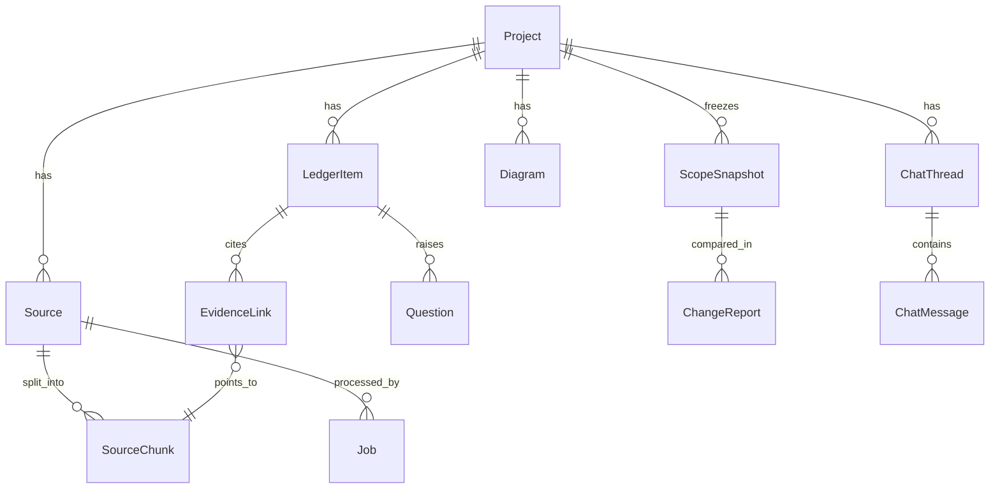
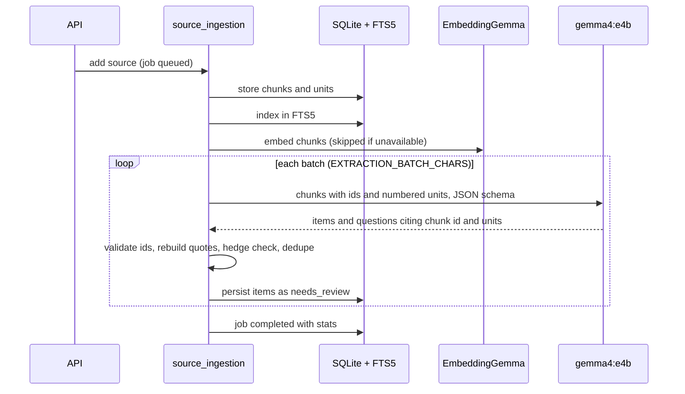
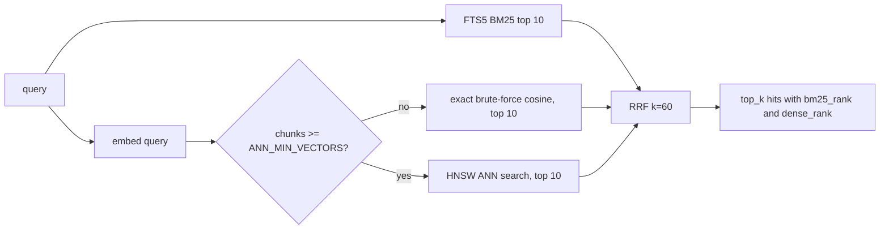
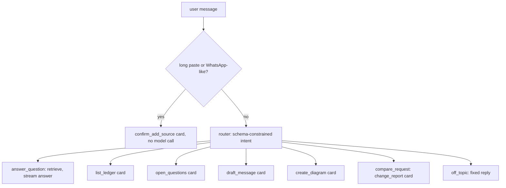

# ArchLens backend

Technical documentation for backend v0.2. For the API contract aimed at UI work see [FRONTEND_HANDOFF.md](FRONTEND_HANDOFF.md); for measured quality see [EVALUATION.md](EVALUATION.md).

## 1. Design goals

1. **Evidence or it does not exist.** Every ledger item must trace to the exact words of a source. Provenance is computed by code, never trusted from the model.
2. **The model proposes, the human decides.** Gemma never approves scope. Snapshots contain approved items only and cannot be edited.
3. **Local only.** All inference goes to a local Ollama server. There is no cloud AI client in the codebase.
4. **Degrade honestly.** If embeddings are missing, retrieval says it is BM25-only. If the model returns invalid output, the job fails with a message instead of storing guesses.

## 2. Stack

| Concern | Choice |
|---|---|
| Web | FastAPI, Pydantic v2, server-sent events for chat |
| Storage | SQLite (WAL, `foreign_keys=ON`, `busy_timeout`), async SQLAlchemy 2 with aiosqlite |
| Lexical search | SQLite FTS5 (BM25), Devanagari combining marks added via `tokenchars` |
| Dense search | EmbeddingGemma through Ollama `/api/embed`, vectors stored as JSON; exact NumPy brute-force cosine below `ANN_MIN_VECTORS` (default 500) per project, an in-memory HNSW index (`hnswlib`) above it, rebuilt when the embedded chunk set changes, falling back to brute force if the library is absent or a build/query fails |
| Fusion | Reciprocal Rank Fusion, `k = 60`, ranks only (scores from the two systems are not comparable), dense channel weight `RRF_DENSE_WEIGHT=2.0` |
| LLM | `gemma4:e4b` through Ollama `/api/chat` with JSON-schema `format`, `think:false`, explicit `num_ctx` and `num_predict` |
| Logging | structlog; private message content is not logged unless `LOG_SENSITIVE_CONTENT=true` |
| Notion export (optional) | Notion REST API via httpx; off until `NOTION_API_KEY`/`NOTION_PARENT_PAGE_ID` are set (section 10) |
| GitHub connector (optional) | GitHub REST API via httpx, read-only; off until `GITHUB_READ_TOKEN` is set (section 10) |

## 3. Layout

```
backend/
  app/
    main.py            app factory, lifespan (DB init, Ollama client), OllamaError handler, CORS
    config.py          Settings (env + .env)
    database.py        engine, pragmas, FTS5 virtual tables (chunk_fts, item_fts)
    models.py          SQLAlchemy models
    schemas.py         LLM output contracts and API payloads
    diagram_specs.py   Pydantic specs for the five diagram types
    enums.py           shared enums
    deps.py            dependency providers (tests override these)
    api/               thin route modules, no business logic
    rate_limit.py      shared slowapi Limiter: app-wide default plus a stricter limit on LLM-cost routes
    services/          all behaviour (below)
    prompts/*.txt      model prompts: extraction, router, answer, change_detection, draft_message, diagram_spec, reformulate_query, change_prompt
    demo/              labelled demo chat and an example incoming request
  scripts/check_setup.py   preflight: FTS5, Ollama, models, schema-constrained smoke test, tokens/s
  tests/                   108 tests, model faked
  evals/                   live evaluation harness (see EVALUATION.md)
```

### Services

| Module | Responsibility |
|---|---|
| `ollama_client.py` | `chat`, `chat_json` (schema validation plus one repair retry), `stream_chat`, `embed`, `health`. Typed errors: unavailable, model missing, timeout, bad response. Hitting `num_predict` is an explicit error, not a truncated answer. |
| `whatsapp_parser.py` | Detects WhatsApp exports (several date formats, ambiguity flagged), extracts senders, timestamps, multi-line messages, system lines. |
| `chunking.py` | Turns messages (or sentences of plain text) into numbered **units** and groups them into chunks of about `CHUNK_TARGET_CHARS`. Units carry sender and time. |
| `source_ingestion.py` | Creates sources, stores chunks, indexes them (FTS5 plus embeddings), runs extraction batches, updates the job with real stages (`reading`, `transcribing` for media, `indexing`, `extracting n/m`). |
| `media_ingestion.py` | PDF, image and audio to text (section 5a). |
| `extraction.py` | Builds the prompt, validates model output, persists items, evidence and questions. |
| `evidence_verification.py` | Rebuilds quotes from stored units and checks free-text phrases with whitespace-normalised exact matching. |
| `hedging.py` | English, Hinglish and Devanagari hedge lexicon. A hedged statement cannot remain `explicit`. |
| `ledger.py` | Display ids (`REQ-1`), duplicate merge by lightly stemmed token Jaccard (threshold 0.75), item serialisation. |
| `lexical_search.py` / `embeddings.py` / `ann_index.py` / `rrf.py` / `hybrid_retrieval.py` | Retrieval (section 6). |
| `snapshots.py` | Immutable baselines from approved items. |
| `change_detection.py` | Classifies an incoming request against a snapshot (section 7). |
| `draft_message.py` | English or Hinglish client message covering open questions. |
| `diagrams.py` / `mermaid_generator.py` | Model fills a structured spec, code compiles Mermaid (section 8). |
| `export_service.py` | Markdown scope brief. |
| `chat_orchestrator.py` | Router, dispatch, grounded answers, one bounded query-reformulation retry, SSE events (section 9). |
| `jobs.py` | Job bookkeeping in short independent transactions so polling sees live progress; `fail_source_and_job` is the one shared failure path both ingestion pipelines use. |
| `notion_export.py` | Converts the Markdown scope brief into Notion blocks and creates a page via the Notion REST API (section 10). |
| `github_client.py` | Read-only GitHub REST API client: repo tree, filtered blob fetch, no git binary, no disk checkout (section 10). |
| `code_ingestion.py` | Chunks a connected repo's files by line range, indexes and embeds them like any other source -- but never runs extraction (section 10). |
| `change_prompt.py` | Ledger item + retrieved code -> an implementation brief for the user's own coding agent, citing only files actually retrieved (section 10). |

## 4. Data model



Key fields:

- **SourceChunk**: `text`, `units_json` (numbered messages with sender and time; empty for code chunks), `embedding_json`, `content_hash`, `location_json` (free-form: `source_label`/`ordinal`/etc. for chat, `file_path`/`start_line`/`end_line` for a connected repo's chunks -- merged into every retrieval hit's `location`, see section 6 and section 10).
- **LedgerItem**: `display_id`, `item_type`, `title`, `description`, `evidence_status` (how firmly it was said), `approval_status` (the human decision), `risk_level`, `stated_by`, `active`.
- **EvidenceLink**: `quote`, `highlight`, `unit_numbers`, `speaker`, `speaker_role`, `verification_status`, `verification_note`.
- **ScopeSnapshot**: `version`, `label`, `snapshot_json` (frozen copy of approved items).
- Timestamps use a UTC-aware `UTCDateTime` type. Deleting a project cascades and also clears the FTS rows.

## 5. Ingestion and extraction pipeline



Provenance rules enforced in code (`extraction.py`, `evidence_verification.py`):

1. The model cites `chunk_id` plus unit numbers. Quotes are reconstructed from the stored units, so they cannot be paraphrased or misquoted. An optional `phrase` is verified by normalised exact match, else the link is marked `unverified`.
2. A citation to a chunk or unit that does not exist is dropped and counted in the job result (`dropped_items`, also `hedge_downgrades`, `items_merged`). An item left with no valid evidence is discarded, never kept.
3. If the cited text contains a hedge, `evidence_status` is lowered from `explicit` to `tentative` and `verification_note` says why.
4. `stated_by` comes from speaker roles (the "you" sender is chosen per source). If any cited unit is by the client, the evidence speaker is the client.
5. New items are always `needs_review`.
6. Any newly created `tentative` item that no model question refers to gets a templated confirmation question (`questions_from_hedges` in the job result), so uncertainty always yields something the user can send to the client.
7. Duplicates (same type, token Jaccard of at least 0.75) merge and add evidence instead of creating a second item.
7. The prompt tells the model that source text is data and that embedded instructions are to be ignored. This reduces prompt-injection risk but is not a security guarantee.

Batch failures are tolerated: if some batches return invalid JSON the job still completes and reports `failed_batches`; if all fail the job fails.

### 5a. File import: PDF, image, audio

`POST /sources/upload` accepts `.txt`/`.md` plus `.pdf`, `.png`, `.jpg`/`.jpeg`, `.webp` and `.wav`. Media files are saved under `ARCHLENS_DATA_DIR/uploads` and transcribed inside the ingestion job (stage `transcribing`); the transcript then goes through the normal chunk, index and extract path.

- **Image**: `gemma4:e4b` vision transcribes visible text line by line (chat screenshots as `Sender: message`); with no text it returns a short factual description.
- **Audio**: sent to Ollama in the message `images` field (the `audio` field is silently ignored). WAV is split into segments of at most 25 seconds (cut at the quietest 100 ms of the last third of each window so words are not split), each transcribed and joined, because the model accepts only short clips. The prompt asks for one punctuated sentence per line; unpunctuated transcripts become oversized units and break the hedge cross-check. Maximum 10 minutes. Other audio formats are not accepted because they were not verified.
- **PDF**: text layer through `pypdf` (at most 30 pages); a page with almost no text is rendered with `pypdfium2` and read by vision (at most 10 such pages). Encrypted PDFs are rejected.
- **Provenance**: evidence from image and audio is stored as `transcript_quote` with the note "Quote is from a model transcript of the uploaded file, not the file itself." `verified` therefore means the quote matches the transcript, not the original media. PDF text-layer evidence stays `text_quote`.
- If Ollama fails an image or audio call (seen once as an out-of-memory 500 when other models were resident on an 8 GB GPU), the text and embedding models are unloaded and the call is retried once.
- Nothing readable (or `[no speech]`) fails the job with "No readable text or speech was found in the file."
- With `analyze=false` a media file is stored but not transcribed until it is analysed.

## 6. Retrieval



- Function words (English and Hinglish) are dropped from the BM25 query unless that would empty it. The dense channel is weighted 2x in fusion because paraphrased queries are where lexical match is weakest (measured in EVALUATION.md).
- Always filtered by `project_id`. Queries are sanitised into quoted FTS tokens (at most 24), so user input cannot inject FTS syntax.
- EmbeddingGemma prompts follow Google's published retrieval templates: queries `task: search result | query: `, documents `title: none | text: `. Ollama's template for the model is raw, so the app adds the prefixes. Both are configurable.
- Vectors are L2-normalised. Brute-force cosine is exact and is what runs below `ANN_MIN_VECTORS` chunks per project (default 500) -- at that scale it is already faster than the ANN build would be.
- Above the threshold, `ann_index.py` keeps one HNSW graph per project in process memory (`hnswlib`, cosine space, `ANN_M`/`ANN_EF_CONSTRUCTION`/`ANN_EF_SEARCH`), rebuilt whenever the embedded chunk id set for that project changes (a plain equality check against the ids just fetched, so staleness is never silently served). It is approximate and purely a speed optimisation: any failure to import, build or query it falls back to the same exact brute-force cosine, never a different answer path. Disable with `ANN_ENABLED=false`.
- Availability of the embed model is cached for 30 s. If embedding fails mid-request the service marks itself unavailable and the response reports `bm25_only`.
- Ledger items are indexed separately (`item_fts`) and searched with BM25 so chat can cite `[L#]` markers.
- **Two retrieval domains, never mixed.** `search_chunks(..., include_code=False)` (the default, used by chat answers and change detection) only ever matches conversation/document sources; `include_code=True` (used only by the change-prompt generator, section 10) only ever matches a connected repo's chunks. Both `lexical_search.search_chunks` and `hybrid_retrieval._dense_ranking` enforce this with a join against `sources.source_type`, so a client's words can never surface as "affected code" and a code snippet can never surface as something the client said. The ANN cache key is domain-scoped too (`"{project_id}:conversation"` / `"{project_id}:code"`), so the two domains don't invalidate each other's cached index when both are queried for the same project.

## 7. Scope lifecycle and change detection

`needs_review -> approved | rejected` is changed only by `PATCH /ledger-items/{id}`. `POST /snapshots` copies approved items into an immutable version.

`compare_request` ingests the incoming text as a source, retrieves older context, and asks the model to classify each claim as `already_covered`, `new_requirement`, `contradiction` or `unclear`, citing baseline display ids. Code then:

- normalises and validates every cited baseline id; a verdict whose cited ids do not exist is downgraded to `unclear`;
- rebuilds supporting quotes from the incoming source;
- files each `new_requirement` as a `needs_review` candidate item (never approved);
- stores a `ChangeReport`. The report has a `draft_message` column, but compare does not populate it today; drafts come from `POST /draft-message`.

## 8. Diagrams

Types: architecture, sequence, ER, component, requirements traceability. The model returns a Pydantic-validated **spec** (nodes, edges, participants and so on), not Mermaid text. `mermaid_generator.py` compiles the spec, sanitises labels, quotes node ids and drops edges that reference undefined nodes, reporting each drop in `warnings_json`. Only active, non-rejected items (at most 40) are given to the model. If there is nothing to draw the service says so instead of inventing content.

## 9. Chat assistant



- Intent is chosen by the model under a JSON schema; if the router output is unusable the turn falls back to `answer_question`. The prompt biases ambiguous short fragments toward `answer_question` (see EVALUATION.md for the measured effect).
- **Grounded answers**: passages (up to 6 chunks and 4 ledger items) are numbered `[C1]..`/`[L1]..`; the answer streams token by token; markers are validated against what was supplied; unknown markers are stripped (`replace` event); if no valid marker remains the turn is flagged `grounded:false`. If retrieval finds nothing the assistant says so without calling the model.
- **Query reformulation (bounded re-planning)**: if the first retrieval for `answer_question` returns nothing at all (no chunks, no ledger items), the orchestrator makes one schema-constrained call (`ReformulateOutput`, prompt `reformulate_query.txt`) asking the model for a differently-phrased search query, and retries retrieval once with it (`MAX_QUERY_REFORMULATIONS = 1`, a hard cap, not a loop the model can extend). The model can only ever propose a search string -- it goes through the exact same FTS sanitisation and embedding path as any other query, and the downstream generation/citation-validation step is completely unchanged. If the model gives up, proposes the same query again, or returns invalid JSON, the turn falls through to the existing honest "couldn't find anything" reply.
- Chat can read, draft, draw and compare, but it cannot approve, reject or snapshot.
- Each assistant message stores its `citations_json` and `cards_json` so history re-renders identically.

Events: `thread`, `status` (stages: `routing`, `searching`, `reformulating`, `writing`, `drawing`, `comparing`, `drafting`), `token`, `replace`, `card`, `citations`, `error`, `done` (formats in FRONTEND_HANDOFF.md).

## 10. Optional integrations

Both are off by default -- no network call to either happens until you set their credentials. Neither touches Ollama or the ledger/extraction pipeline.

### 10a. Notion export

`POST /projects/{id}/export/notion` (`notion_export.py`). No model call: it re-uses the exact markdown `export_service.build_markdown()` already produces for the Markdown export and converts it into Notion blocks with a narrow converter (headings, flat bullets, paragraphs -- only the line shapes `build_markdown` actually emits, not a general markdown parser), then creates a page via the Notion API under `NOTION_PARENT_PAGE_ID`, titled after the project. Batches appends in groups of 100 blocks (Notion's per-request limit). `NotionNotConfigured` (501) if either setting is missing; `NotionError` (502) on any API/network failure.

### 10b. GitHub code intelligence (read-only)

`POST /projects/{id}/sources/github` (`github_client.py`, `code_ingestion.py`). Connects a repo (`owner/repo` or a full URL, optional `ref`) via the GitHub REST API only -- no `git clone`, no disk checkout, no write scope on the token.

- `github_client.py` fetches the file tree (`git/trees?recursive=1`), filters out vendor/build directories, lockfiles, and oversized (`>200 KB`) or non-text-extension files, then fetches blobs with bounded concurrency (8 at a time) and decodes them, skipping anything that isn't valid UTF-8 (a binary file that slipped past the extension filter).
- `code_ingestion.py` chunks each file by line range (80 lines per chunk, `location_json: {file_path, start_line, end_line}`) and runs it through the exact same `lexical_search.index_chunks` / `embedder.embed_documents` pipeline every other source uses.
- **A github_repo source never runs `extraction.py`.** It produces zero ledger items and zero evidence links -- a codebase is reference material for "what does this requirement touch", not something a client said. See section 6 for how the two domains stay partitioned at retrieval time.
- Honest failure: zero files found (wrong ref, or nothing matched the extension allowlist) fails the job with a readable message rather than silently completing empty.

### 10c. Implementation-brief handoff

`POST /ledger-items/{id}/prompt` (`change_prompt.py`). Turns one ledger item into a short brief for the user's own coding agent -- this is the terminal, read-only output of the whole pipeline; ArchLens never writes to the repo, opens a branch, or creates a PR itself.

1. Retrieves up to 8 candidate chunks from the connected repo (`include_code=True`) using the item's title + description as the query.
2. The model is given those candidates only as `[F#]` markers -- real paths are withheld specifically so the model cannot write out a path of its own.
3. After generation, any `[F#]` the model used that was not actually supplied is stripped (same discipline as the chat assistant's `[C#]`/`[L#]` citation handling); every marker it legitimately used is substituted, in code, for the real `file_path:start_line-end_line`.
4. `target` (`generic` / `claude_code` / `cursor` / `github_copilot`) changes only a short audience-framing preamble in the prompt sent to the model -- never the grounding rules above.
5. `NoRepositoryConnected` (409) if the project has no github_repo source yet; `NoLedgerItem` (404) for an unknown item.

## 11. Configuration

See the table in the README. Notable: `OLLAMA_THINK=false` is required in practice because Gemma 4 is a thinking model and can exhaust `num_predict` before emitting JSON. `OLLAMA_NUM_CTX=16384` fits the extraction batches; raising it increases VRAM use.

New in this revision: `ANN_ENABLED`, `ANN_MIN_VECTORS`, `ANN_M`, `ANN_EF_CONSTRUCTION`, `ANN_EF_SEARCH` (section 6); `RATE_LIMIT_ENABLED`, `RATE_LIMIT_DEFAULT` (app-wide), `RATE_LIMIT_LLM` (the stricter per-IP limit on `POST /sources`, `/sources/upload`, `/sources/github`, `/chat`, `/diagrams`, `/compare`, `/draft-message`, `/ledger-items/{id}/prompt` -- the routes that call Gemma). Tests run with `RATE_LIMIT_ENABLED=false` (set in `conftest.py`) since the HTTP test suite fires far more than the default LLM limit at these routes in one process. `NOTION_API_KEY`/`NOTION_PARENT_PAGE_ID` and `GITHUB_READ_TOKEN` (section 10) are unset by default -- their features simply return a clear 501/409 until configured, never a crash.

## 12. Operations

```bash
cd backend
python -m scripts.check_setup          # preflight with a schema-constrained smoke test
uvicorn app.main:app --port 8000       # docs at /docs
pytest                                 # 108 tests, no Ollama needed
python -m evals.run_evals              # live evaluation, needs Ollama with both models
```

- Data lives in `ARCHLENS_DATA_DIR` (SQLite file and uploads). It is git-ignored. If that folder is inside a synced directory such as OneDrive it will sync, so keep it outside for sensitive client data.
- Schema creation uses `create_all`; there is no migration tool yet. Changing a model means recreating the database.
- Single-process, single-user: no authentication. Per-IP rate limiting exists (`rate_limit.py`, section 11) but is not a substitute for auth -- it bounds abuse of local Ollama calls, it does not gate access. The GitHub and Notion integrations are likewise single-user by design: one token for the account running ArchLens, not a per-user OAuth flow. Per-user OAuth was deliberately scoped out: this tool is not deployed as a multi-tenant service, and adding cloud account auth for a single practitioner's tool would have diluted the local-first privacy story without adding real value.

## 13. Testing strategy

| Layer | What is covered |
|---|---|
| Unit | WhatsApp parsing (formats, ambiguous dates, multi-line), chunking, hedge lexicon, quote verification, RRF, FTS5 including Hindi and hostile queries, Mermaid compilation and sanitising, GitHub repo-string parsing and file filtering, line-range chunking |
| Service | Extraction provenance (dropped ids, hedge lowering, dedupe, speaker role), hybrid retrieval and the BM25-only fallback with a fake embedder, the code/conversation retrieval domain partition, snapshots, change classification downgrade, GitHub ingestion producing zero ledger items |
| API | Full HTTP flow, project isolation, chat streaming and grounding, query reformulation, Notion export (configured and unconfigured paths), GitHub source connection, change-prompt marker stripping/substitution, error mapping |
| Live | `evals/` (real Gemma): extraction recall, router accuracy, retrieval, change detection, invariants. The Notion, GitHub and change-prompt features were each additionally live-verified by hand against the real Notion/GitHub APIs and the real Ollama model (not just the automated suite) when they were built. |

The unit and API tests use `FakeLLM`, `FakeEmbedder`, `FakeNotionClient` and `FakeGitHubClient`, so they prove the logic around the model/external APIs, not their quality or availability. Quality claims come only from the live evals.

## 14. Known limitations

- Media import is verified only with generated files (clean rendered text, synthesized English speech). Real photos, noisy audio, Hinglish speech, handwriting and long recordings are untested; audio is WAV only.
- Extraction can miss items and the router is not guaranteed; see EVALUATION.md for the measured rates and the small size of the test sets.
- Duplicate detection is lexical, so paraphrased duplicates may remain separate.
- Hinglish drafts can mix English.
- No migrations, auth, or background worker queue (jobs run in FastAPI background tasks within the server process).
- The ANN index is per-process memory only: it is not persisted and is rebuilt (from the embeddings already in SQLite) the first time a project crosses `ANN_MIN_VECTORS` after a restart, and again whenever that project's embedded chunk set changes.
- Query reformulation retries at most once and only reformulates the search query, never the final answer; it does not help when retrieval found something but it was the wrong thing (that failure mode is still just `grounded:false`).
- GitHub code intelligence has no static analysis or dependency graph -- "affected files" is retrieval (BM25 + dense), not an AST/import-graph analysis. One repo chunking strategy (80 lines, no language-aware splitting) for every language. A large monorepo can hit `MAX_FILES` (500) or the per-file `200 KB` cap and silently skip the rest (logged, not surfaced to the API caller today).
- The GitHub connector and the change-prompt generator are single-user: one token for the whole app, no per-repo or per-user access control beyond what that one token's own scope grants.
- The change-prompt generator only ever retrieves code; it cannot yet see or reason about an existing open PR, CI status, or the repo's commit history.
